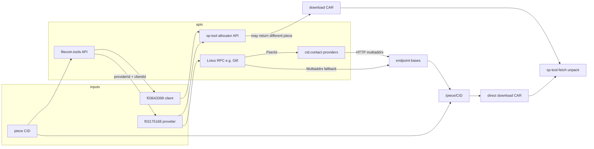

# DUV — Download, unpack, and verify (Filecoin)

Tools for **retrieving data from Filecoin storage providers** using **piece CIDs**, **deal metadata from [filecoin.tools](https://filecoin.tools)**, and optionally the **[SP Tool allocator API](https://api.sp-tool.allocator.tech)**. This repo also includes a **safe CAR unpack** path that avoids mutating your original download.

Primary goals:

- Resolve **`http(s)://<host>:<port>/piece/<pieceCid>`** when you know (or discover) the miner.
- Prefer **filecoin.tools** for “which SPs hold this piece?” style lookups instead of relying on IPNI for that step.
- **Unpack** padded or tricky CARv1 files without destroying the source file.

---

## Repository layout

| File | Role |
|------|------|
| [`sp-tool-fetch.sh`](#sp-tool-fetchsh) | Allocator API → job or sync URL → download CAR → unpack (or unpack-only / install-deps). |
| [`cid-to-download.sh`](#cid-to-downloadsh) | Piece CID → provider discovery → SP HTTP bases → build `/piece/…` URLs → print or download (optional sp-tool). |
| [`cid-sp-fetch.sh`](#cid-sp-fetchsh) | filecoin.tools search → **random** deal → same SP, direct `/piece/<cid>` download (optional allocator modes). |
| [`cid-all-sp-piece-urls.sh`](#cid-all-sp-piece-urlssh) | filecoin.tools **all pages** → **every unique SP** → JSON list of endpoints and piece URLs. |
| [`lib_piece_endpoints.sh`](#lib_piece_endpointssh) | Shared: Lotus `StateMinerInfo` + cid.contact + Lotus multiaddr decode → HTTP base URLs. **Not run directly.** |

---

## How the pieces fit together

You usually work with a **piece CID** (often a `baga…` string). Retrieval over HTTP is commonly:

```text
{providerBase}/piece/{pieceCid}
```

where `providerBase` is something like `http://203.0.113.10:3105`.



**Important distinction**

- **Direct `/piece/<yourCid>`** — Targets **that** piece on **that** miner (as long as the SP serves it on that base URL).
- **`sp-tool-fetch.sh` / allocator** — Asks the service for **a** retrievable URL for the **client** (and optional provider). The returned CAR is **not guaranteed** to be the same piece CID you started with.

---

## Requirements

| Need | Used by |
|------|---------|
| `bash`, `curl`, `jq` | All shell scripts |
| `wget` or `curl` | Downloads (`cid-to-download`, `cid-sp-fetch` via `cid-to-download`, `sp-tool-fetch`) |
| `python3` | `lib_piece_endpoints.sh` (decode Lotus base64 multiaddrs when cid.contact has no HTTP addrs) |
| `storacha` CLI (optional) | `cid-to-download.sh` fallback if filecoin.tools has no row |
| `car`, `ipfs-car`, and/or `car-pad` | `sp-tool-fetch.sh` unpack / `--install-deps` |

---

## `sp-tool-fetch.sh`

End-to-end helper for the **allocator**: create a job (or poll the sync client URL), take the **first** `http(s)` URL from the response, download, then unpack.

### Modes

1. **Install dependencies** (no sudo; macOS uses Homebrew for system packages, user-space for car tooling where possible).
2. **Fetch + unpack** — `--client` required; `--provider` optional to narrow miners.
3. **Unpack only** — No network; safe clone + optional truncate + extract.

### Usage

```bash
chmod +x sp-tool-fetch.sh

# Dependencies (optional)
./sp-tool-fetch.sh --install-deps --os macos
./sp-tool-fetch.sh --install-deps --os debian --install-deps-only

# Allocator → download → unpack
./sp-tool-fetch.sh --client f03643399 --dir ./output
./sp-tool-fetch.sh --client f03643399 --provider f03175168 --dir ./output

# Unpack a file you already have (original never modified in place)
./sp-tool-fetch.sh --unpack-only ./output/myfile.car --dir ./output
```

### Notable flags and environment

| Flag / env | Meaning |
|------------|---------|
| `--api-base URL` / `API_BASE` | Default `https://api.sp-tool.allocator.tech` |
| `--timeout` / `POLL_TIMEOUT` | Async job poll limit (default 900s) |
| `--sync-timeout` / `SYNC_TIMEOUT` | Sync GET poll limit (default 900s) |
| `PREFER_IPFS_CAR=1` | Prefer `ipfs-car` for unpack |
| `ALLOW_COPY=1` / `--allow-copy` | Allow full copy if reflink/APFS clone unsupported |

On **HTTP 405** from `POST /job`, the script **falls back** to polling `GET …/url/client/{client}` until a URL appears.

---

## `cid-to-download.sh`

Resolve **direct piece retrieval URLs** for a **piece CID**, optionally download.

### Flow

1. **Find a provider** (unless `--provider` is set):  
   `GET https://api.filecoin.tools/api/search?filter=<pieceCid>` (first hit), then optional **storacha**, then optional **cid.contact** `/cid/…`.
2. **Resolve HTTP bases** for that miner (via `lib_piece_endpoints.sh`):  
   cid.contact **provider** record → HTTP multiaddrs; if none, **Lotus** `StateMinerInfo.Multiaddrs` (base64 multiaddr → `http://ip:port`).
3. Build **`{base}/piece/{pieceCid}`** for each base.
4. **Print** one or all URLs, or **download** to `DIR/<pieceCid>.car`, trying **each** candidate URL until one succeeds.

### Options

| Option | Effect |
|--------|--------|
| `--url-only` | Print first URL (use with `--all-urls` to print every candidate line). |
| `--download DIR` | Download into `DIR`; tries every built URL in order. |
| `--provider f0…` | Skip filecoin.tools/storacha/cid lookup for provider; still resolves endpoints for that miner. |
| `--client f0…` | Set client (for logging / `--use-sp-tool`). |
| `--use-sp-tool` | With `--download` and client: run `sp-tool-fetch.sh` instead of direct URLs (piece may differ). |
| `--no-filecoin-tools` | Skip filecoin.tools for step 1. |
| `-h`, `--help` | Help. |

### Examples

```bash
./cid-to-download.sh baga6ea4seaq… --url-only
./cid-to-download.sh baga6ea4seaq… --all-urls --url-only
./cid-to-download.sh baga6ea4seaq… --provider f03175168 --download ./out
```

---

## `cid-sp-fetch.sh`

Convenience script: **filecoin.tools** paginated search with **`limit=10`**, **`page=1`**, pick **one random** row, then download **that** piece from **that** SP using the same direct `/piece/<cid>` logic as `cid-to-download.sh`.

### Options

| Option | Effect |
|--------|--------|
| *(default)* | Direct download; tries **all** HTTP bases for the chosen SP before failing. |
| `--sp-tool` | Skip direct URLs; only `sp-tool-fetch.sh` for that client+provider. |
| `--sp-fallback` | If every direct URL fails, run `sp-tool-fetch.sh` (**may fetch a different piece**). |

```bash
./cid-sp-fetch.sh baga6ea4seaq… ./output
./cid-sp-fetch.sh --sp-fallback baga6ea4seaq… ./output
./cid-sp-fetch.sh --sp-tool baga6ea4seaq… ./output
```

After a successful **direct** download, unpack with:

```bash
./sp-tool-fetch.sh --unpack-only ./output/baga6ea4seaq….car --dir ./output
```

---

## `cid-all-sp-piece-urls.sh`

Enumerate **every unique `providerId`** returned by filecoin.tools for a piece CID (**paginated** search), then for **each** SP output structured JSON with **all** resolved `providerEndpoint` + `pieceUrl` pairs.

### Output shape

```json
{
  "data": [
    {
      "providerId": "f03175168",
      "pieceUrls": [
        {
          "providerEndpoint": "http://203.0.113.1:3105",
          "pieceUrl": "http://203.0.113.1:3105/piece/baga6ea4seaq…"
        }
      ]
    }
  ]
}
```

If an SP has **no** resolvable HTTP base, it still appears with `"pieceUrls": []`.

### Options and environment

| Option / env | Effect |
|--------------|--------|
| `-c`, `--compact` | Single-line JSON. |
| `FILECOIN_TOOLS_API` | API base (default `https://api.filecoin.tools/api`). |
| `SEARCH_PAGE_LIMIT` | Page size (default `100`). |
| `LOTUS_RPC`, `CID_CONTACT_BASE` | Same as `cid-to-download.sh` / library. |

```bash
./cid-all-sp-piece-urls.sh baga6ea4seaq… | jq .
./cid-all-sp-piece-urls.sh -c baga6ea4seaq…
```

**Performance:** One Lotus (+ optional cid.contact) round trip **per unique provider**; large replication counts can be slow.

---

## `lib_piece_endpoints.sh`

Sourced by `cid-to-download.sh` and `cid-all-sp-piece-urls.sh`. Defines:

- `get_miner_info <f0miner>` — POST Lotus `Filecoin.StateMinerInfo`.
- `get_provider_http_endpoints_from_cid_contact <peerId>` — GET `https://cid.contact/providers/<peerId>`, parse `/ip4/…/tcp/…/http(s)` style multiaddrs.
- `get_provider_http_endpoints_from_lotus <minerInfoJson>` — Decode base64 multiaddrs to `http://ip:port`.

Defaults: `LOTUS_RPC=https://api.node.glif.io/rpc/v1`, `CID_CONTACT_BASE=https://cid.contact`. Override before sourcing or via environment when invoking the parent scripts.

---

## Choosing a workflow

| Goal | Suggested path |
|------|----------------|
| “Get **this** piece from **one** random replica” | `cid-sp-fetch.sh <cid> ./out` |
| “List **all** SPs and **all** `/piece/` URLs as JSON” | `cid-all-sp-piece-urls.sh <cid>` |
| “I already know **f0provider**” | `cid-to-download.sh <cid> --provider f0… --download ./out` |
| “Use allocator / Fil+ tooling only” | `sp-tool-fetch.sh --client f0… [--provider f0…] --dir ./out` |
| “Unpack only” | `sp-tool-fetch.sh --unpack-only ./file.car` |

---

## Troubleshooting

- **404 on `/piece/…` for one base** — `cid-to-download` / `cid-sp-fetch` try other bases for the same SP. Try another SP (`cid-sp-fetch` again) or inspect full list with `cid-all-sp-piece-urls.sh`.
- **Allocator returns a different `baga…` than you asked for** — Expected: sync/job URL is **per client**, not per piece. Avoid `--sp-fallback` unless you accept that tradeoff.
- **filecoin.tools search empty** — Wrong CID, or not indexed; try storacha (`cid-to-download` fallback) or another data source.
- **No HTTP endpoints for a miner** — cid.contact empty and Lotus multiaddrs missing or undecodable; that SP may still be reachable via other tooling.
- **CAR unpack errors (zero-length section / padding)** — Use `PREFER_IPFS_CAR=1` or let `sp-tool-fetch.sh` clone+truncate; see script comments and `--allow-copy` if clone fails.
- **`jq` errors with URLs** — `cid-all-sp-piece-urls.sh` builds endpoint arrays with `--argjson` (not `--args`) for compatibility with various `jq` builds.

---

## License

MIT
